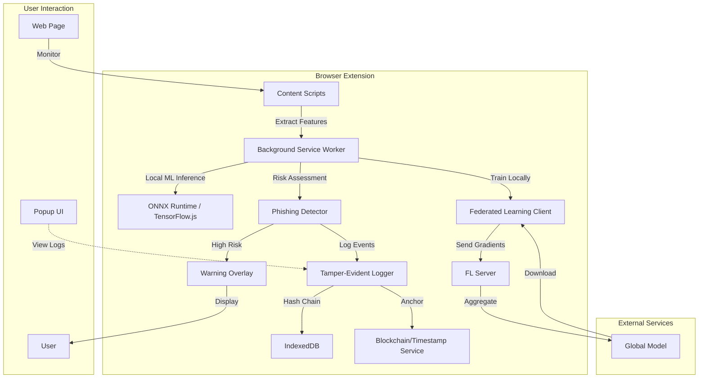

# Secure Agentic Browser Extension - Implementation Plans

## Overview
This directory contains detailed 4-step implementation plans for building a secure Chrome extension on top of Nanobrowser with on-device phishing detection, federated learning, and tamper-evident logging.

## Quick Navigation

### [Phase 1: Chrome Extension Foundation](./phase1-chrome-extension-foundation.md)
Build the secure Chrome extension skeleton using Manifest V3, strict permissions, and early risk assessment.

**Key Deliverables:**
- Manifest V3 with minimal permissions
- Integration with Nanobrowser's multi-agent workflow
- Background URL/content risk checker
- Security audit (OWASP, Snyk)

**Estimated Time:** 1-2 weeks

---

### [Phase 2: Local-First Data Processing & Federated Learning](./phase2-local-first-federated-learning.md)
Implement browser-based ML with TensorFlow.js/ONNX and privacy-preserving federated learning.

**Key Deliverables:**
- ONNX Runtime or TensorFlow.js integration
- Local feature extraction and storage (IndexedDB)
- Federated learning client with differential privacy
- Periodic model updates from server

**Estimated Time:** 2-3 weeks

---

### [Phase 3: On-Screen Content Scanning & Phishing Detection](./phase3-content-scanning-phishing-detection.md)
Build comprehensive content analysis with DOM scanning, ML-based detection, and user warnings.

**Key Deliverables:**
- Content scripts for DOM analysis
- Optional screenshot capture and OCR
- ML-based phishing classifier
- Risk-based warning/blocking system

**Estimated Time:** 2-3 weeks

---

### [Phase 4: Tamper-Evident Logging](./phase4-tamper-evident-logging.md)
Create cryptographic audit logs with hash chains, Merkle trees, and optional blockchain anchoring.

**Key Deliverables:**
- Hash-chained audit log (SHA-256)
- Merkle tree block batching
- Blockchain/timestamp anchoring (OpenTimestamps)
- Audit viewer UI with verification

**Estimated Time:** 1-2 weeks

---

### [Phase 5: Core Development (Models & Code)](./phase5-core-development-models-code.md)
Train custom ML models from scratch and build secure, well-tested codebase.

**Key Deliverables:**
- PhishTank/Alexa training dataset (50k+ URLs)
- Random Forest classifier (>95% accuracy)
- Secure coding practices (no eval, validated inputs)
- Comprehensive test suite (80%+ coverage)

**Estimated Time:** 3-4 weeks

---

### [Phase 6: Mac (M1/M4) Compatibility & Performance](./phase6-mac-compatibility-performance.md)
Optimize for Apple Silicon with GPU acceleration and cross-platform validation.

**Key Deliverables:**
- Cross-platform dependency compatibility
- WebGPU acceleration (2-5x speedup)
- Performance optimization (<50ms analysis)
- Full Mac testing and CI/CD

**Estimated Time:** 1-2 weeks

---

## Total Timeline
**Estimated:** 10-16 weeks for complete implementation

## Architecture Overview

## Key Technologies

| Component | Technology | Purpose |
|-----------|-----------|---------|
| **Extension Framework** | Manifest V3, Chrome Extensions API | Browser integration |
| **ML Inference** | ONNX Runtime Web, TensorFlow.js | Local phishing detection |
| **ML Training** | scikit-learn, Python | Model development |
| **GPU Acceleration** | WebGPU, WebGL | Fast inference on Mac |
| **Privacy** | Federated Learning, Differential Privacy | Privacy-preserving training |
| **Logging** | SHA-256, Merkle Trees, OpenTimestamps | Tamper-evident audit trail |
| **Storage** | IndexedDB, Web Crypto API | Encrypted local data |
| **Testing** | Jest, Puppeteer | Unit, integration, E2E tests |

## Security Principles

1. **Least Privilege**: Minimal permissions in manifest
2. **Defense in Depth**: Multiple layers of security
3. **Privacy by Design**: All data stays local
4. **Secure by Default**: CSP, input validation, no unsafe code
5. **Transparency**: Open-source, auditable logs
6. **Continuous Validation**: Automated testing and security scans

## Getting Started

### For Execution
1. **Start with Phase 1**: Read [phase1-chrome-extension-foundation.md](./phase1-chrome-extension-foundation.md)
2. **Follow Each Step**: Each plan has 4 detailed steps with code examples
3. **Verify Before Proceeding**: Complete verification checklist before next phase
4. **Iterate as Needed**: Adjust plans based on findings

### For Agents
Each plan provides:
- **Clear Objectives**: What to accomplish in each step
- **Detailed Actions**: Specific code, commands, and configurations
- **Expected Outcomes**: Success criteria for each step
- **Verification Checklists**: How to validate completion

All plans are self-contained with enough context to execute independently.

## Support Resources

- **Original Design**: [secure-agentic-browser-extension-6-phase-development-plan.txt](../secure-agentic-browser-extension-6-phase-development-plan.txt)
- **Nanobrowser Repo**: https://github.com/nanobrowser/nanobrowser
- **Chrome Extension Docs**: https://developer.chrome.com/docs/extensions/
- **PhishTank**: https://phishtank.org/
- **ONNX Runtime Web**: https://onnxruntime.ai/docs/tutorials/web/

---

**Ready to begin?** Start with [Phase 1: Chrome Extension Foundation →](./phase1-chrome-extension-foundation.md)
